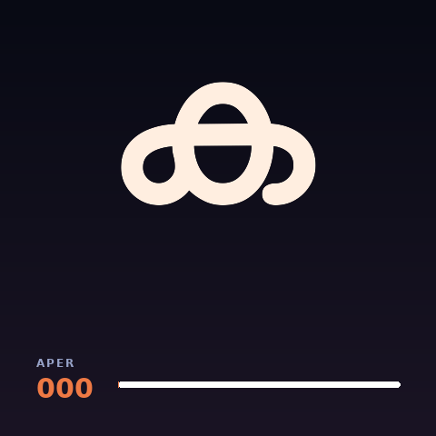
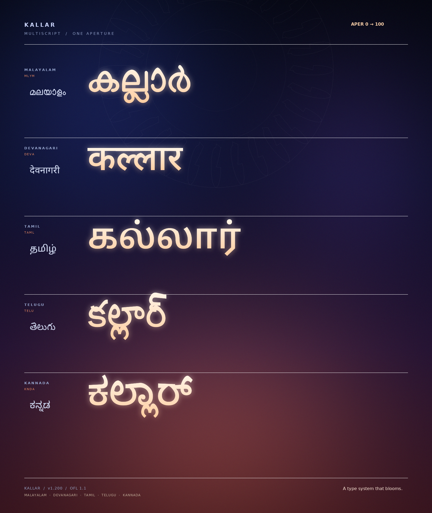

Could I build a Malayalam font with coding agents?

I knew font design could take a long time. In a
[2017 post](https://thottingal.in/blog/2017/09/14/how-to-design-a-new-malayalam-font/),
[Santhosh Thottingal](https://thottingal.in/) wrote that Chilanka took him about two
months and Manjari about a year and a half. Not full-time, but a project refined in
the few hours left after work.

Around then I came across Andrej Karpathy's
[HackerTube](https://karpathy.bearblog.dev/hacker-tube/?full=1). He built it in about
two hours on a Saturday. The speed is the headline, but what I liked was the format:
he had an idea, gave it to a coding agent, and then showed the working thing along
with how it was made. I wanted to try the same with a font.

# What a few days of prompting got me

I gave the agent a few prompts, including a direction to explore a Malayalam font in
conversation with existing work such as Manjari and Nupuram. The result became Kallar. I
don’t claim the Malayalam loop forms or the APER idea as inventions of my own; this
project is an experiment in applying them to a font built on existing designs.

After a few days my experiment became Kallar, which is a working family, more or less.
The repo has variable fonts, static Round and Petal instances, Spectrum builds, seven styles
for each script, interactive specimens and tests. The Malayalam family has 918 glyphs in Regular.
The tests run HarfBuzz shaping at `APER` 0, 50 and 100 for every script, check character coverage
and colour tables, and FontBakery reports zero FAIL results for the eight multiscript Regular/Bold
variable fonts, with documented exclusions.

Getting there took two or three days of prompting. That part is fun, and I won't pretend
otherwise.

At `APER 0` the counter is a classic round loop. At `APER 100`, which is the default, its
crown lifts into a soft point, so the negative space reads like a lotus petal or a temple
doorway. The axis has five stops in all, and the outer silhouette follows with a gentler
version of the same gesture. Nothing is pasted on top; the outlines themselves change.

There is also colour. Kallar Spectrum carries a blue-to-orange gradient inside the font
with COLRv1, blue at the crown and orange near the baseline, so a paragraph reads as one
continuous field instead of separately coloured letters.

I did not draw these letters from scratch. Every family sits on
[Manjari](https://fonts.thottingal.in/manjari/)'s skeleton. Manjari also supplies the
Latin, digits, punctuation, spacing and metrics. For the four scripts Manjari has no
letters for, Noto Sans donates only those script-specific letters. The aperture engine,
the axis, the metrics, the Spectrum builds and the specimens are the new work here. I
want that to be clear, because it is easy to show a font and let people assume you drew
all of it.

The code and proofs are on [GitHub](https://github.com/kurianbenoy/kallar).

## The critique that changed the question

But a font that builds is not the same as a type design that works. I sent it to
Santhosh, and he was kind enough to look at it. He told me that the output is
aesthetically bad: you can clearly see ink bloats and cuts, distorted curves and not
having a uniform design. He also asked the harder question:

> If the aim is to speed up type design, is it more meaningful to modify an existing font,
> or to use code to help create a design from the start?

That question stayed with me.

## A working build is not a finished design

The gap between the two is where most of my learning happened. My tools could move
points, interpolate outlines, generate colour fonts and run tests. None of that makes
the result visually coherent. The tests tell me the font behaves as intended; they
cannot tell me if a curve feels right.

In Kallar the letter skeletons are inherited. The counter treatment is an experiment on
top of Manjari, not a new Malayalam typeface.

## What code and agents are good at

Santhosh's own work is the better model here. Nupuram is built around a clear visual idea
and four variable axes, and every glyph starts as a MetaPost program. In his newer
[Cocolata](https://fonts.thottingal.in/cocolata/) project, he takes that further: give a
coding agent a base design and components, and it can assemble a functional letter in
code. He reviews the result and adjusts the ratios until it looks right. Cocolata is
still in beta. The automation helps the process, but it does not make the design
decisions.

I also liked [OpenCode's font project](https://opencode.ai/font), though for a different
reason. It takes six letters from the wordmark and turns them into a small, tightly
constrained typeface, then shows the construction, measurements and specimens on the
page. It is a good example of how to present a project: show the thing and show how it
was made, instead of just saying AI made it.

I am lucky that Santhosh took the time to review it. It is not every day that the person
who designed lot of popular fonts in Malayalam looks at the work.

## What's coming next?

I don’t have a next step yet. I treated Kallar as an experiment in building a font,
and it isn’t nearly good enough to call a finished typeface. I want to learn more about
type design and find a distinct design idea before continuing. I started with an engineering
question—could I build a font?—but I’ve learned that the design needs to come first.

I feel it's better to understand more about type design, come up with a unique idea and then design
a font. Instead of trying to vibe code a unique font with a engineering mindset.